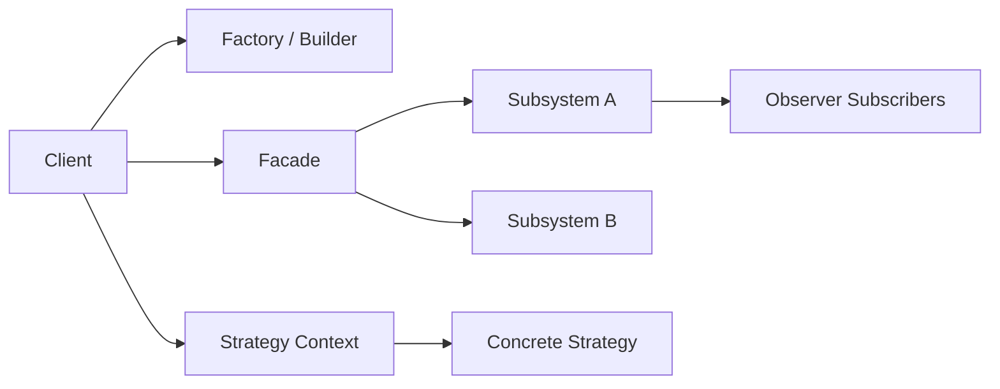

# Java Design Patterns Explained with Practical Examples

## Why This Matters

Most production Java systems eventually solve the same design problems: object creation sprawl, fragile dependencies, and unclear communication between components. Design patterns provide time-tested solutions that help teams make decisions consistently.

## Problem Statement

Without shared design approaches, codebases usually suffer from:

- Hard-coded object creation and tight coupling
- Duplicate orchestration logic
- Rigid class hierarchies
- Behavioral changes that require touching too many files

Patterns do not replace good engineering judgment—they accelerate it.

## Core Concepts

Design patterns are commonly grouped into:

1. **Creational**: object creation strategies
2. **Structural**: composition and object relationships
3. **Behavioral**: communication and responsibility flow

## How It Works

### Creational Patterns

- **Singleton**: one shared instance (e.g., configuration reader).
- **Factory Method**: defer concrete type creation to subclasses/factories.
- **Abstract Factory**: create related object families consistently.
- **Builder**: construct complex objects step-by-step.
- **Prototype**: clone existing objects when creation is expensive.

### Structural Patterns

- **Adapter**: make incompatible interfaces work together.
- **Bridge**: separate abstraction from implementation.
- **Composite**: treat trees and leaves uniformly.
- **Decorator**: add behavior dynamically.
- **Facade**: expose a simpler API over complex subsystems.
- **Flyweight**: share repeated state to reduce memory.
- **Proxy**: control access to another object.

### Behavioral Patterns

- **Chain of Responsibility**: pass request through handlers.
- **Command**: encapsulate operations as objects.
- **Observer**: publish-subscribe updates.
- **Strategy**: swap algorithms at runtime.
- **Template Method**: define algorithm skeleton + overridable steps.
- Plus: Interpreter, Iterator, Mediator, Memento, State, Visitor.

## Example

### Factory Method (creation decoupling)

```java
interface Notification {
    void send(String msg);
}

class EmailNotification implements Notification {
    public void send(String msg) { System.out.println("Email: " + msg); }
}

class SmsNotification implements Notification {
    public void send(String msg) { System.out.println("SMS: " + msg); }
}

abstract class NotificationFactory {
    abstract Notification create();

    public void dispatch(String msg) {
        Notification notification = create();
        notification.send(msg);
    }
}

class EmailFactory extends NotificationFactory {
    Notification create() { return new EmailNotification(); }
}
```

### Strategy (runtime behavior switching)

```java
interface PaymentStrategy {
    void pay(double amount);
}

class CardPayment implements PaymentStrategy {
    public void pay(double amount) { System.out.println("Card payment: " + amount); }
}

class UpiPayment implements PaymentStrategy {
    public void pay(double amount) { System.out.println("UPI payment: " + amount); }
}

class CheckoutService {
    private PaymentStrategy strategy;

    public CheckoutService(PaymentStrategy strategy) {
        this.strategy = strategy;
    }

    public void setStrategy(PaymentStrategy strategy) {
        this.strategy = strategy;
    }

    public void checkout(double amount) {
        strategy.pay(amount);
    }
}
```

## Common Pitfalls

- Applying patterns “because they exist,” not because they solve a concrete pain.
- Building deep inheritance trees where composition would be simpler.
- Hiding straightforward code behind unnecessary abstractions.
- Confusing similar patterns (e.g., Factory vs Builder vs Abstract Factory).

## Best Practices

- Start from the problem; map to a pattern only when structure repeats.
- Prefer readability over theoretical purity.
- Use interfaces where variation is expected.
- Keep examples and production code aligned with SOLID principles.
- Document why a pattern is used in code comments or ADRs.

## Advanced Notes

### Quick Pattern Selection Matrix

| Scenario | Recommended Pattern |
|---|---|
| Need one shared instance | Singleton |
| Need pluggable object creation | Factory Method |
| Need families of compatible objects | Abstract Factory |
| Constructor has many optional params | Builder |
| Need runtime algorithm swap | Strategy |
| Need event broadcast to listeners | Observer |
| Need command queue/undo | Command |
| Need to simplify many subsystems | Facade |

### Architecture View



## Key Takeaways

- Patterns are reusable design vocabulary for recurring engineering problems.
- Creational, structural, and behavioral categories solve different classes of issues.
- The best pattern choice minimizes coupling while keeping code understandable.
