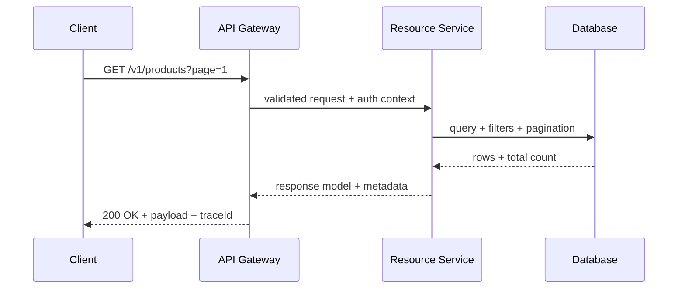

# REST API Design Guidelines: A Practical Playbook for Reliable APIs

## Why This Matters

APIs become long-lived contracts. Small design mistakes in naming, versioning, status codes, or error responses become expensive once clients depend on them. A disciplined REST style improves developer experience, reliability, and operational safety.

## Problem Statement

Many APIs are hard to consume because they mix transport concerns, business semantics, and inconsistent conventions. Typical symptoms include:

- Action-style URLs (`/getUser`) instead of resource modeling
- Inconsistent status codes and error payloads
- Missing pagination/filter conventions
- Weak security defaults and poor observability

## Core Concepts

A production-grade REST API should be:

- **Resource-oriented**: nouns, not verbs
- **HTTP-semantic**: methods/status codes used correctly
- **Stateless**: each request carries complete context
- **Consistent**: predictable naming and response formats
- **Secure and observable**: auditable, throttled, monitored

## How It Works

### Resource and URI design

- Use plural nouns: `/users`, `/orders/{orderId}`.
- Keep naming lowercase and hyphenated where needed.
- Limit nesting depth, e.g., `/users/{id}/orders`.
- Version APIs intentionally (`/v1/...` or header-based).

### HTTP methods and semantics

- `GET`: read-only, cacheable, safe.
- `POST`: create or trigger non-idempotent operations.
- `PUT`: full replacement/upsert, idempotent.
- `PATCH`: partial update.
- `DELETE`: remove resource, should be idempotent behaviorally.

### Status code discipline

- `200 OK`, `201 Created`, `204 No Content`
- `400 Bad Request`, `401 Unauthorized`, `403 Forbidden`, `404 Not Found`, `409 Conflict`, `422 Unprocessable Entity`
- `500/502/503` for server/upstream failures

### Request and response conventions

- Use JSON as the default format.
- Support filtering, sorting, and pagination in query params.
- Return stable envelope structures for success and failure.
- Include correlation IDs in headers for tracing.

### Security and operations

- Enforce HTTPS everywhere.
- Use token-based auth (e.g., OAuth2/JWT) appropriately.
- Add rate limiting and clear quota responses.
- Emit structured logs and latency/error metrics.

## Example

### Example endpoint set

```http
GET    /v1/products?category=laptop&page=1&pageSize=20&sort=price,asc
GET    /v1/products/{productId}
POST   /v1/products
PATCH  /v1/products/{productId}
DELETE /v1/products/{productId}
```

### Example validation error payload

```json
{
  "error": {
    "code": "VALIDATION_ERROR",
    "message": "Request validation failed",
    "details": [
      { "field": "price", "issue": "must be greater than zero" }
    ],
    "traceId": "4ec2b5fd7f82455d"
  }
}
```

## Common Pitfalls

- Returning `200` for all outcomes, including failures.
- Using business verbs in URLs and overloading `POST` everywhere.
- Breaking clients with silent response schema changes.
- Ignoring deprecation strategy and backward compatibility.

## Best Practices

- Publish OpenAPI documentation and keep it versioned.
- Define API style rules (naming, paging, errors) once and enforce them.
- Add contract tests for critical endpoints.
- Treat error payload design as a first-class contract.
- Provide clear deprecation timelines and migration notes.

## Advanced Notes

### API lifecycle checklist

| Lifecycle Stage | Recommendation |
|---|---|
| Design | Model resources and contracts before implementation |
| Build | Implement validation, idempotency rules, and auth |
| Test | Add integration + contract + load tests |
| Operate | Monitor SLIs (latency, error rate, saturation) |
| Evolve | Version deliberately and communicate deprecations |

### Request flow overview



## Key Takeaways

- Great REST APIs optimize for consistency and predictability.
- Correct HTTP semantics reduce ambiguity and client bugs.
- Security, documentation, and observability are part of API design—not post-launch add-ons.
