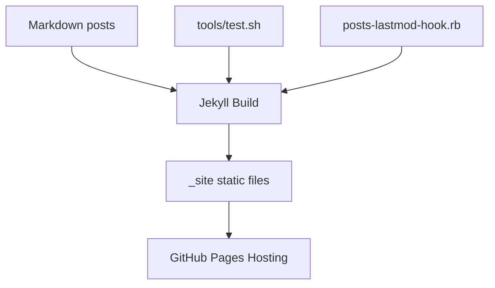

# Jekyll Chirpy for Engineering Blogs: Local Workflow, Build Checks, and Publishing

## Why This Matters

A writing workflow is only sustainable when local preview, verification, and publishing are predictable. This repository already includes practical automation for that workflow.

## Problem Statement

Teams often rely on manual ad-hoc blog publishing steps, which leads to broken links, missed metadata updates, and deployment surprises.

## Core Concepts

This repository uses:

- **Jekyll + Chirpy theme** for blog rendering
- **`tools/run.sh`** for local serving
- **`tools/test.sh`** for build and link checks
- **`_plugins/posts-lastmod-hook.rb`** for automatic `last_modified_at`
- **`_config.yml`** for site identity, timezone, SEO metadata, and behavior

## How It Works

### Local authoring loop

```bash
bash tools/run.sh
```

Options:

- `-H` / `--host`: bind host for local or container workflows
- `-p` / `--production`: run with production environment flags

### Build + validation loop

```bash
bash tools/test.sh
```

This script:

1. Cleans `_site`
2. Builds with `JEKYLL_ENV=production`
3. Runs `htmlproofer` (external links disabled by default)

### Metadata automation

The plugin hook checks git history and sets post `last_modified_at` automatically when a post has more than one commit.

## Example

### Typical publish flow

1. Write or edit a post under `_posts/`
2. Preview locally with `bash tools/run.sh`
3. Validate site with `bash tools/test.sh`
4. Commit and push to the GitHub Pages branch/repository

### High-level architecture



## Common Pitfalls

- Forgetting to run build checks before pushing.
- Inconsistent timezone handling across local machines.
- Editing configuration without verifying generated output.
- Assuming `README.md` changes appear on site (it is excluded in config).

## Best Practices

- Keep drafts small and run local preview frequently.
- Run `tools/test.sh` before every publish.
- Use meaningful post front matter (`title`, `categories`, `author`).
- Keep repository docs (`README.md`, `BLOG_INDEX.md`) in sync with posts.

## Advanced Notes

- `_config.yml` supports analytics, comments, PWA behavior, and social previews—enable only what you actively maintain.
- The repository timezone is configured as `Asia/Kolkata`; date-sensitive content should explicitly mention absolute dates when precision matters.

## Key Takeaways

- Good blog infrastructure reduces cognitive load for technical writing.
- Build/test scripts and metadata hooks turn publishing into a repeatable engineering workflow.
- Treat content operations like software delivery: preview, validate, then publish.
