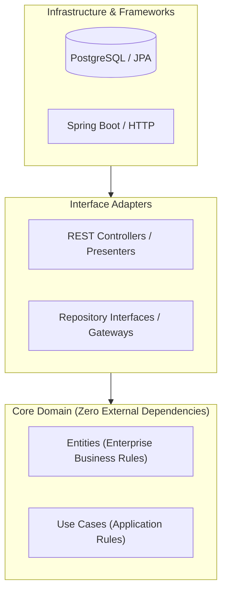

**Clean Architecture** enforces the **Dependency Inversion Principle**: source code dependencies must point inward toward high-level domain policy, never outward toward frameworks or databases.

## Architectural Layers



---

## The Dependency Rule

- **Entities**: Encapsulate high-level business rules and data models. They have **no** knowledge of Spring, JPA, HTTP, or JSON.
- **Use Cases**: Orchestrate flow of data to and from Entities.
- **Interface Adapters**: Convert data between format convenient for Use Cases and external agents (e.g. DTOs $\leftrightarrow$ Domain Entities).
- **Frameworks & Drivers**: DB drivers, web frameworks, external API clients.

```java title="TransferMoneyUseCase.java"
// Pure domain Java interface with zero framework dependencies
public interface TransferMoneyUseCase {
    void transfer(AccountId source, AccountId destination, Money amount);
}
```

:::tip[Architectural Audit]
Domain entities should reside in a pure Java module that does not import `org.springframework.*` or `jakarta.persistence.*`.
:::
