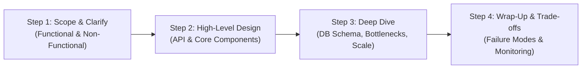

A structured 4-step approach to navigate ambiguous system design interview prompts.

## 4-Step Interview Framework

---

## Back-of-the-Envelope Estimation Rules

### Memory & Storage Equivalents

| Unit | Value | Bytes |
| :--- | :--- | :--- |
| **1 KB** | $10^3$ bytes | $2^{10}$ bytes |
| **1 MB** | $10^6$ bytes | $2^{20}$ bytes |
| **1 GB** | $10^9$ bytes | $2^{30}$ bytes |
| **1 TB** | $10^{12}$ bytes | $2^{40}$ bytes |
| **1 PB** | $10^{15}$ bytes | $2^{50}$ bytes |

### Throughput Calculations

$$\text{Seconds in a Day} \approx 86,400 \approx 10^5 \text{ seconds}$$

- **1 Million Daily Active Users (DAU)** making 10 requests/day:

$$\text{QPS} = \frac{10,000,000}{86,400} \approx 115 \text{ queries/second}$$

- **Peak QPS**: Multiply average QPS by $2 \times$ to $5 \times$ safety factor ($\approx 500 \text{ peak QPS}$).

:::tip[Latency Numbers Every Engineer Should Know]
- L1 cache reference: 0.5 ns
- Main memory (RAM) read: 100 ns
- Read 1 MB sequentially from memory: 250,000 ns (0.25 ms)
- Read 1 MB sequentially from SSD: 1,000,000 ns (1 ms)
- Round trip within same datacenter: 500,000 ns (0.5 ms)
- Send packet CA to Netherlands & back: 150,000,000 ns (150 ms)
:::
