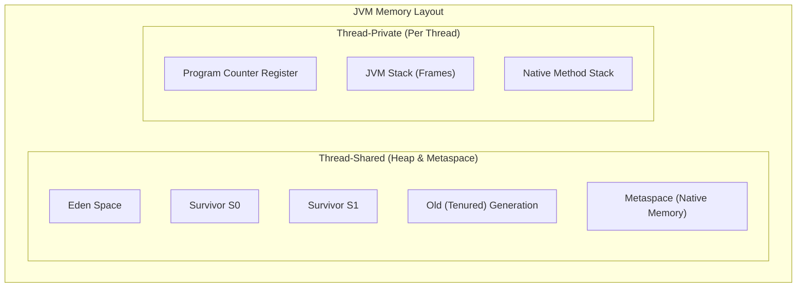

Understanding the **Java Memory Model (JMM)** and JVM runtime data areas is critical for building high-throughput, thread-safe Java applications.

## JVM Runtime Data Areas

The JVM splits runtime memory into **Thread-Shared** areas and **Thread-Private** areas:



### 1. Heap Memory
- **Young Generation**:
  - **Eden Space**: Where new objects are initially allocated.
  - **Survivor Spaces (S0 / S1)**: Objects surviving Minor GC iterations transition between S0 and S1.
- **Old (Tenured) Generation**: Long-lived objects promoted after crossing the age threshold (`-XX:MaxTenuringThreshold`).

### 2. Metaspace (Native Memory)
- Replaced **PermGen** in Java 8.
- Holds class metadata, bytecode, constant pools, and method definitions in off-heap OS memory.

:::tip[Performance Tuning]
Configure `-XX:MaxMetaspaceSize` in production to prevent unbounded off-heap native memory growth from dynamic class loading (e.g. CGLIB proxies).
:::

---

## Happens-Before Guarantees

The JMM defines precise rules for memory visibility across threads:

1. **Volatile Variable Rule**: A write to a `volatile` field *happens-before* every subsequent read of that same field.
2. **Monitor Lock Rule**: An unlock operation on a monitor *happens-before* every subsequent lock on the same monitor.
3. **Thread Start Rule**: A call to `Thread.start()` *happens-before* any action in the started thread.

### Code Sample: Double-Checked Locking Pattern

```java title="ThreadSafeSingleton.java" ins={4}
public class ThreadSafeSingleton {
    // volatile ensures memory barrier, preventing instruction reordering
    private static volatile ThreadSafeSingleton instance;

    private ThreadSafeSingleton() {}

    public static ThreadSafeSingleton getInstance() {
        if (instance == null) {
            synchronized (ThreadSafeSingleton.class) {
                if (instance == null) {
                    instance = new ThreadSafeSingleton();
                }
            }
        }
        return instance;
    }
}
```

:::caution[Memory Leak Gotcha]
ThreadLocal variables retain object references in the `ThreadLocalMap` attached to worker threads in thread pools. Always invoke `.remove()` in a `finally` block to avoid thread-pool memory leaks.
:::
