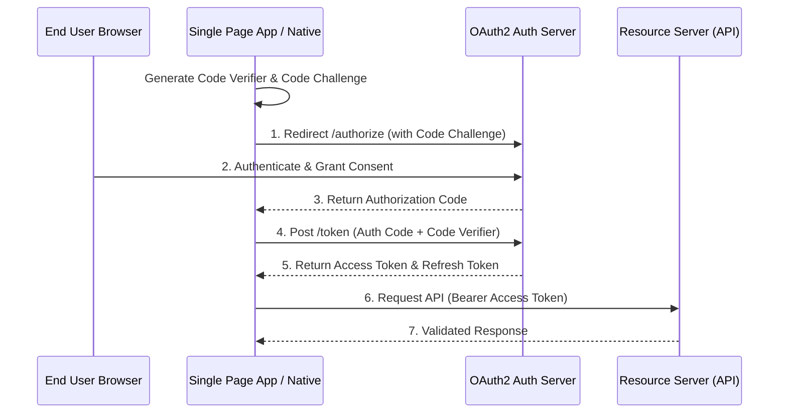

Modern API security relies on **OAuth 2.0** for delegated authorization and **OIDC (OpenID Connect)** for authentication.

## Authorization Code Flow with PKCE



---

## JWT Claims Structure

A JSON Web Token consists of three base64url-encoded parts separated by dots (`.`): `Header.Payload.Signature`

```json title="jwt_payload.json"
{
  "iss": "https://auth.company.com/",
  "sub": "user_984214",
  "aud": "https://api.company.com",
  "exp": 1770542400,
  "iat": 1770538800,
  "roles": ["ROLE_USER", "ROLE_ADMIN"]
}
```

:::danger[Security Vulnerability Warning]
Never rely solely on client-side decoding. The Resource Server **must** cryptographically verify the signature against the Auth Server's JWKS (JSON Web Key Set) public key and validate `exp`, `iss`, and `aud` claims before granting access.
:::
