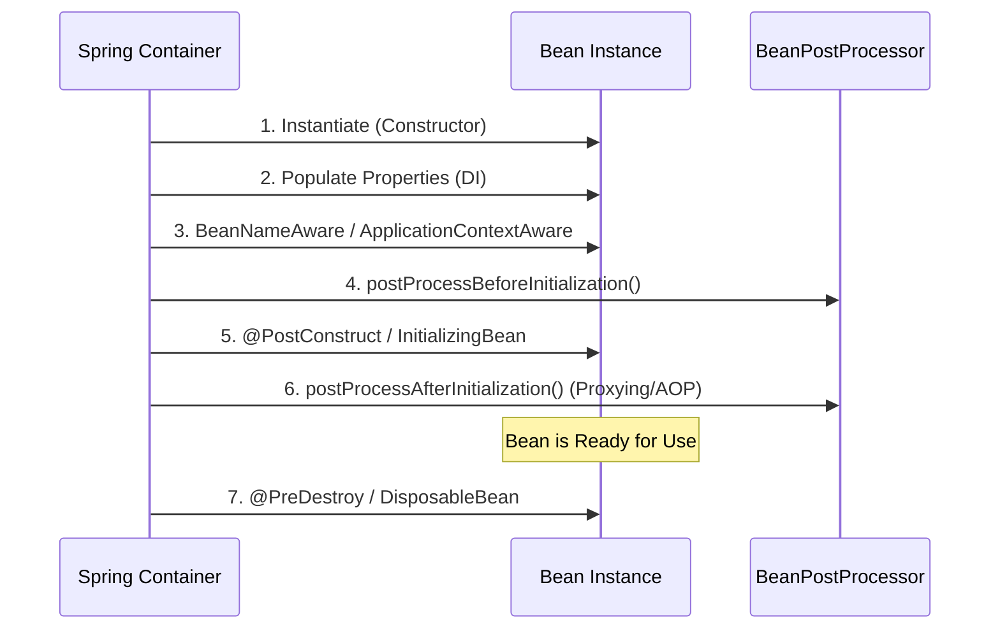

The Spring ApplicationContext manages the lifecycle of beans from creation to destruction.

## Lifecycle Execution Flow



---

## Key Phases Explained

1. **Instantiation**: The container creates the bean instance using constructor reflection.
2. **Populate Properties**: Dependencies injected via `@Autowired` field, setter, or constructor injection.
3. **Aware Interfaces**: Spring injects container-level references if implemented (`BeanNameAware`, `ApplicationContextAware`).
4. **BeanPostProcessor (Before Initialization)**: Custom transformations prior to initialization hooks.
5. **Initialization**: Custom init logic executed (`@PostConstruct` or `afterPropertiesSet()`).
6. **BeanPostProcessor (After Initialization)**: AOP dynamic proxy wrapping (e.g., `@Transactional` or `@Async` proxy generation).

```java title="OrderService.java"
@Service
public class OrderService implements InitializingBean, DisposableBean {

    private final PaymentClient paymentClient;

    // Preferred: Constructor Injection
    public OrderService(PaymentClient paymentClient) {
        this.paymentClient = paymentClient;
    }

    @PostConstruct
    public void init() {
        // Phase 5: Executed after property injection
    }

    @Override
    public void afterPropertiesSet() throws Exception {
        // Interface-based initialization
    }

    @PreDestroy
    public void cleanup() {
        // Phase 7: Executed during ApplicationContext shutdown
    }

    @Override
    public void destroy() throws Exception {
        // Interface-based cleanup
    }
}
```

:::tip[Best Practice]
Always use **Constructor Injection** over Field Injection (`@Autowired` on fields). Constructor injection makes dependencies immutable, simplifies unit testing without Spring context, and prevents circular dependency bugs at startup.
:::
