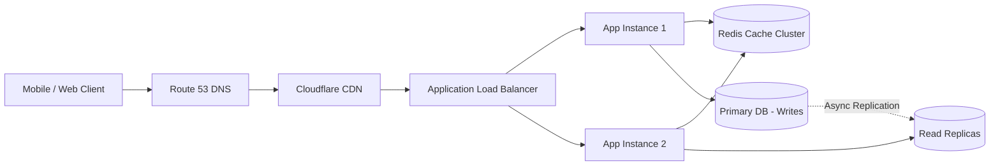

Designing web-scale architectures requires balancing availability, latency, data consistency, and operational complexity.

## Scalable Architecture Pattern

---

## Key Design Patterns

### 1. Consistent Hashing
Used in distributed caching (e.g. Memcached, Redis Cluster) and Cassandra to minimize key reshuffling when nodes join or leave the ring:

$$\text{Hash Slot} = \text{hash}(\text{Key}) \pmod{2^{32}}$$

- **Virtual Nodes**: Assign multiple tokens/ring slots to physical nodes to prevent hot-spotting and ensure uniform load distribution.

### 2. Caching Strategies

- **Cache-Aside (Lazy Loading)**: App reads from cache; on miss, reads from DB and updates cache.
- **Write-Through**: App writes to cache; cache synchronously writes to DB.
- **Write-Back (Write-Behind)**: App writes to cache; cache asynchronously batches writes to DB.

:::caution[Cache Stampede / Thundering Herd]
When a hot cache key expires, thousands of concurrent requests miss cache simultaneously and overwhelm the primary database. Mitigate with **Mutex Locks** or **Probabilistic Early Expiration (XFetch)**.
:::
