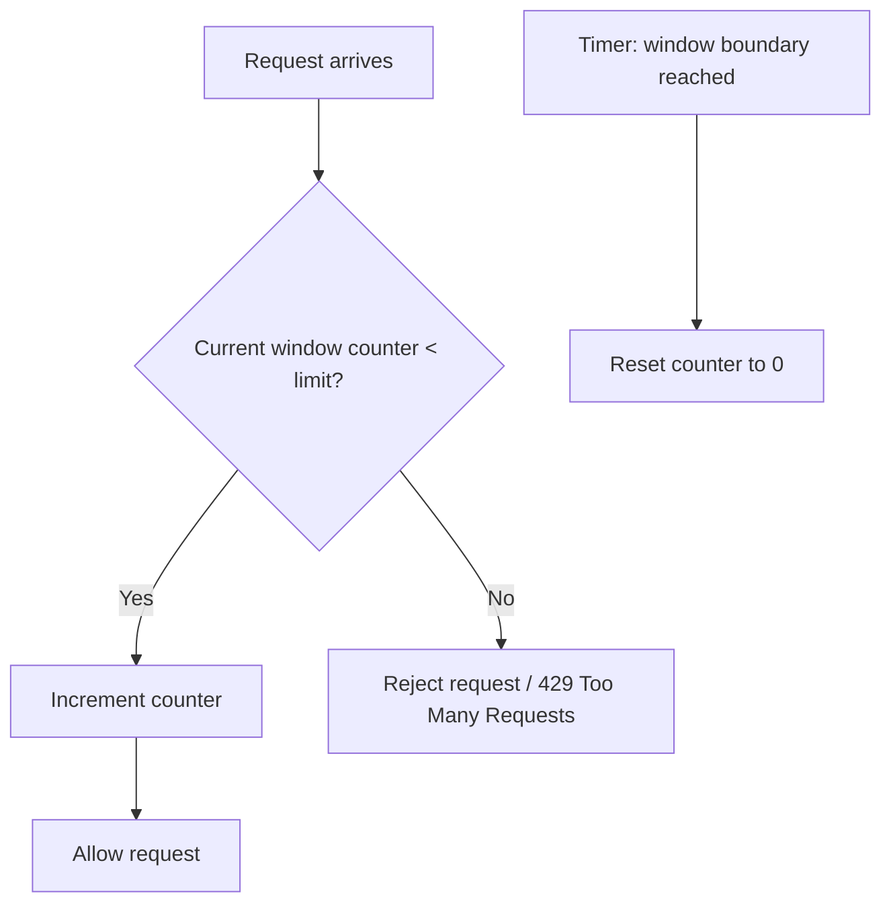
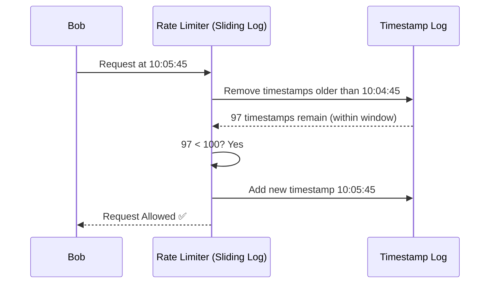
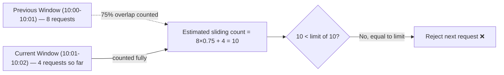
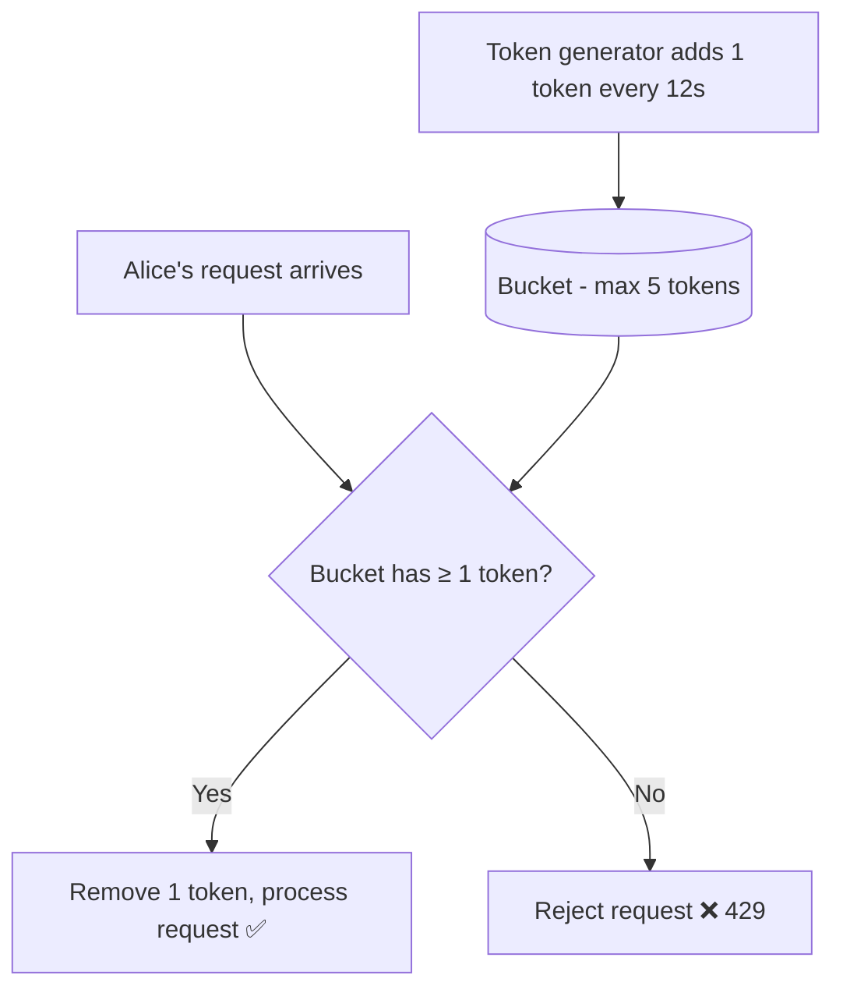
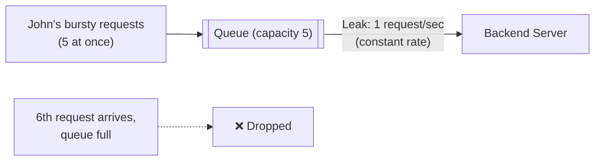
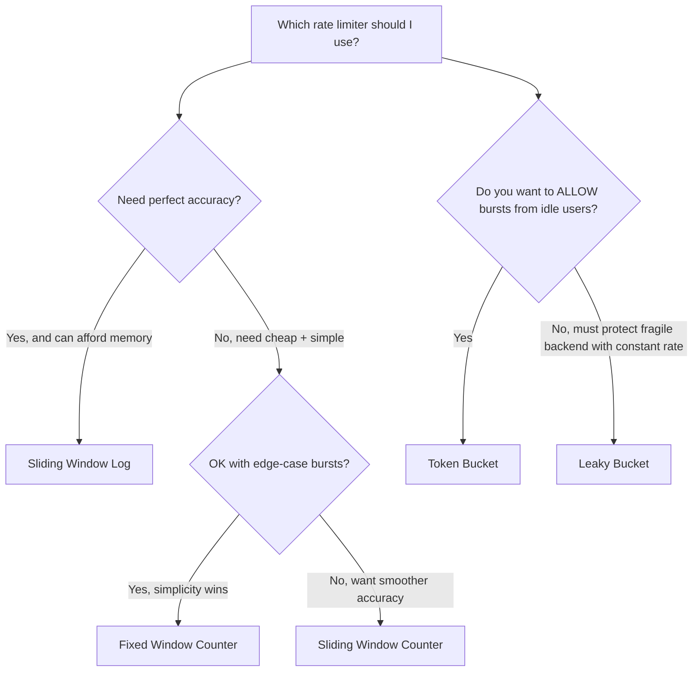

## 1. What is Rate Limiting and Why is it Necessary?

**Rate limiting** is a technique used to control how many requests a client (a user, an app, an IP address, or an API key) is allowed to make to a system within a given period of time.

Think of it like a nightclub with a bouncer. The club has a capacity limit — if too many people rush in at once, the place gets crowded, service quality drops, and someone might get hurt. The bouncer controls the *rate* at which people enter, even if the total crowd wandering outside is huge.

### Why it's necessary

- **Protects backend resources** — prevents a server, database, or downstream service from being overwhelmed and crashing.
- **Ensures fair usage** — stops one aggressive user from starving everyone else of resources (multi-tenant fairness).
- **Defends against abuse** — mitigates brute-force login attempts, credential stuffing, scraping, and DDoS-style traffic spikes.
- **Cost control** — for metered/paid APIs (e.g., SMS gateways, LLM APIs), rate limiting keeps usage — and cost — predictable.
- **SLA enforcement** — lets a provider offer different tiers of service (e.g., free vs. premium users get different quotas).

### Running example characters

To keep things concrete, we'll use:

- **Alice** — a free-tier user of an API (limit: 5 requests/minute)
- **Bob** — a premium user (limit: 100 requests/minute)
- **John** — a bot/script that tries to hammer the server with rapid requests

## 2. Different Types of Rate Limiting (Algorithms)

There are five widely used algorithms:

| Algorithm | Core Idea | Smoothness | Memory Use |
|---|---|---|---|
| Fixed Window Counter | Count requests per fixed time block | Choppy (boundary bursts) | Very low |
| Sliding Window Log | Store timestamp of every request | Perfectly smooth | High |
| Sliding Window Counter | Weighted average of two windows | Smooth approximation | Low |
| Token Bucket | Tokens refill over time, requests consume tokens | Smooth, allows bursts | Low |
| Leaky Bucket | Requests processed at a constant fixed rate via a queue | Perfectly smooth output | Low-Medium |

Let's go through each one.

## 3. Detailed Explanation of Each Type

### 3.1 Fixed Window Counter

**How it works:** Time is divided into fixed-size windows (e.g., every 60 seconds, starting at :00). A counter tracks how many requests arrived in the *current* window. Once the counter hits the limit, further requests are rejected until the window resets.

**Example:** Alice is limited to 5 requests/minute. The window resets every minute on the clock (10:00:00, 10:01:00, 10:02:00...).

- 10:00:05 → Alice makes request 1 (count = 1) ✅
- 10:00:10 → Alice makes request 2 (count = 2) ✅
- ... Alice makes 3 more, hitting count = 5 ✅
- 10:00:50 → Alice's 6th request ❌ Rejected (limit reached for this window)
- 10:01:00 → Window resets, count = 0. Alice can make 5 more requests immediately.

**The Boundary Burst Problem:** This is the well-known flaw. If Alice sends 5 requests at 10:00:59 and then 5 more at 10:01:01, she has effectively sent **10 requests in 2 seconds**, even though she technically respected the "5 per window" rule — because those requests fell into two different windows right next to each other.

```mermaid
gantt
    title Fixed Window Counter - Boundary Burst Problem
    dateFormat X
    axisFormat %S s
    section Window 1 (0-60s)
    5 requests allowed :done, w1, 0, 60
    Alice's 5 reqs near end (55-59s) :crit, a1, 55, 59
    section Window 2 (60-120s)
    5 requests allowed :done, w2, 60, 120
    Alice's next 5 reqs near start (60-64s) :crit, a2, 60, 64
```





**Pros:** Extremely simple, cheap memory (one counter per user per window).

**Cons:** Allows bursts of 2x the limit at window edges.

### 3.2 Sliding Window Log

**How it works:** Instead of a single counter, the system stores a **timestamp for every request** a user makes (in a log, list, or sorted set). When a new request comes in, the system removes all timestamps older than "now minus window size," then checks if the remaining count is under the limit.

**Example:** Bob is limited to 100 requests/minute using a sliding log.

- Bob's request log (last 60s) currently has 99 timestamps.
- Bob sends request #100 at 10:05:30 → Allowed, timestamp logged. Log = 100 entries.
- Bob sends request #101 at 10:05:45 → System looks at the log, discards any timestamp older than 10:04:45. Suppose 3 old timestamps get discarded → log now has 97 → request allowed.
- If no old entries can be discarded (Bob was very active), request is rejected.

This means the window "slides" continuously with time — there's no fixed boundary to exploit, so there's no burst problem like in Fixed Window.



**Pros:** Perfectly accurate — no boundary burst issue at all.

**Cons:** Memory-hungry (must store a timestamp per request per user); more expensive to compute at high scale, since every check requires pruning the log.

### 3.3 Sliding Window Counter

**How it works:** A practical compromise between Fixed Window (cheap but inaccurate) and Sliding Log (accurate but expensive). It keeps counters for the *current* and *previous* fixed windows, then estimates the sliding count using a weighted average based on how far into the current window we are.

**Formula:**

```
estimated_count = (previous_window_count * overlap_percentage) + current_window_count
```

**Example:** John is limited to 10 requests/minute.

- Previous window (10:00:00–10:01:00): John made 8 requests.
- Current window (10:01:00–10:02:00): It's now 10:01:15, so we're 25% into the current window, meaning 75% of the previous window still "overlaps" with our sliding view.
- John has made 4 requests so far in the current window.
- Estimated count = (8 × 0.75) + 4 = 6 + 4 = **10** → John's next request would be rejected, since it would push the estimate over the limit.



**Pros:** Much cheaper than Sliding Log (just two counters), and smooths out the boundary burst problem significantly.

**Cons:** It's an *approximation*, not perfectly precise — assumes requests are evenly distributed within the previous window, which isn't always true.

### 3.4 Token Bucket

**How it works:** Imagine a bucket that holds tokens, with a maximum capacity. Tokens are added to the bucket at a fixed rate (e.g., 1 token every 6 seconds → 10 tokens/minute). Every incoming request must "spend" one token to be processed. If the bucket is empty, the request is rejected (or queued). Crucially, if a user has been idle, tokens accumulate up to the bucket's max — allowing a **burst** of activity when they return.

**Example:** Alice's bucket holds a max of 5 tokens, refilling at 1 token per 12 seconds (5/minute overall).

- Alice has been away all morning → bucket is full: 5 tokens.
- 9:00:00 → Alice fires off 5 requests instantly (checking her dashboard) → all 5 succeed, bucket now has 0 tokens. This is the "burst allowance."
- 9:00:05 → Alice tries a 6th request → ❌ Rejected, bucket empty.
- 9:00:12 → One token refills → bucket has 1 token. Alice's next request ✅ succeeds.



**Pros:** Allows natural, controlled bursts (great for user-facing APIs where usage is bursty, like a dashboard refresh). Widely used (e.g., AWS API Gateway).

**Cons:** Slightly more complex to implement; burst behavior may not be desirable for protecting fragile downstream systems.

### 3.5 Leaky Bucket

**How it works:** Requests come into a queue (the "bucket") of fixed size. They are processed ("leaked" out) at a **constant, fixed rate**, regardless of how fast they arrived. If the queue is full when a new request arrives, it's dropped/rejected. Unlike Token Bucket, Leaky Bucket smooths out *all* traffic into a steady, constant outflow — it does not allow bursts to pass through to the backend.

**Example:** John's requests are limited via a leaky bucket that processes exactly 1 request/second, with a queue capacity of 5.

- 10:10:00.0 → John sends 5 requests all at once (a burst). All 5 go into the queue (queue full: 5/5).
- 10:10:00.1 → John sends a 6th request → ❌ Rejected, queue is full.
- 10:10:01.0 → Bucket "leaks" — 1 request is processed, queue now has 4/5 free slot opens.
- 10:10:02.0 → Another request processed, queue 3/5, and so on — output is a smooth, constant trickle of 1 request/second no matter how bursty John's input was.



**Pros:** Produces a perfectly smooth, predictable outflow rate — ideal for protecting a downstream system that can only handle a steady, constant load (e.g., a legacy payment processor).

**Cons:** Bursty-but-legitimate traffic gets queued/delayed or dropped even if the *average* rate is fine; can add latency since requests wait in the queue.

### Token Bucket vs. Leaky Bucket — the key difference

This distinction trips people up, so here's the crux:

- **Token Bucket** controls how many requests can go out, but *lets them go out as fast as they arrive*, as long as tokens are available (bursty output allowed).
- **Leaky Bucket** controls the **rate of outflow itself** — output is always smooth and constant, regardless of how requests arrived (no bursty output, ever).

Think of Bob at an all-you-can-eat buffet (Token Bucket) — he can grab 5 plates at once if he has 5 "plate tokens" saved up. Versus John at a factory conveyor belt (Leaky Bucket) — no matter how many items get placed on the belt, only one comes out the other end every second.

## 4. Quick Comparison Summary



| Scenario | Best Fit |
|---|---|
| Alice checks a dashboard occasionally, then refreshes rapidly | **Token Bucket** (allows burst) |
| John's bot traffic must be smoothed to protect a legacy payment system | **Leaky Bucket** (constant output) |
| Simple public API, cost of occasional edge-burst is acceptable | **Fixed Window Counter** |
| Bob is a premium user and you need strong fairness guarantees without huge memory cost | **Sliding Window Counter** |
| Financial/security-critical endpoint where precision matters most | **Sliding Window Log** |
